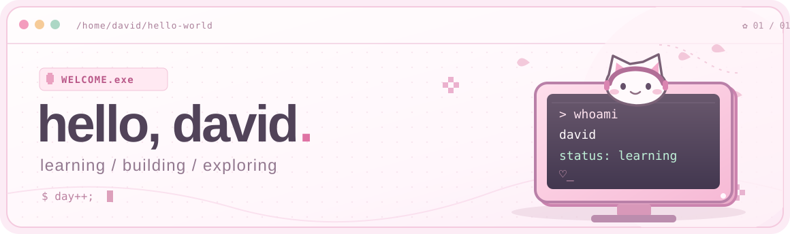

 

<samp>hello, i'm david. just learning & making things.</samp>

  

<a href="https://github.com/its-david-li?tab=repositories">repositories</a> · <a href="https://github.com/its-david-li?tab=stars">stars</a> · <a href="https://github.com/its-david-li#user-activity-overview">contributions</a>

  

  

